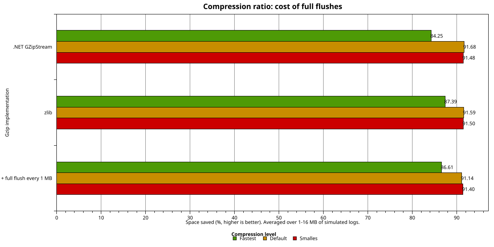
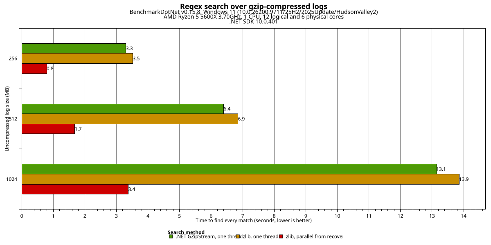

[//]: # (https://www.markdownguide.org/basic-syntax/#reference-style-links)

[![.NET][DotNet]][DotNet-url][![LinkedIn][linkedin-shield]][linkedin-url]


<!-- PROJECT LOGO -->
<a id="readme-top"></a>
<br />
<div align="center">
  <h3 align="center">ZLib Random Access</h3>

  <p align="center">
    Exploring a feature of the ZLib Library
    <br />
    <a href="#performance">View Benchmarks</a>
  </p>
</div>

<!-- TABLE OF CONTENTS -->
<details>
  <summary>Table of Contents</summary>
  <ol>
    <li>
      <a href="#about-the-project">About The Project</a>
      <ul>
        <li><a href="#built-with">Built With</a></li>
      </ul>
    </li>
    <li>
      <a href="#performance">Performance</a>
    </li>
    <li>
      <a href="#getting-started">Getting Started</a>
      <ul>
        <li><a href="#prerequisites">Prerequisites</a></li>
        <li><a href="#running-the-benchmarks">Running the Benchmarks</a></li>
      </ul>
    </li>
    <li><a href="#usage">Usage</a></li>
    <li><a href="#roadmap">Roadmap</a></li>
    <li><a href="#acknowledgments">Acknowledgments</a></li>
  </ol>
</details>

<!-- ABOUT THE PROJECT -->
## About The Project

[//]: # (TODO: Add a screen shot of the final UI)
[//]: # ([![Product Name Screen Shot][product-screenshot]]&#40;https://example.com&#41;)

This project explores a feature of the ZLib library: the 'Full Flush'. A full flush resets the compression algorithm, so the compressed bytes after it do not depend on anything before it. The .NET BCL class for writing GZip files (`GZipStream`) does not expose it, so this project calls ZLib directly.

Decompression can therefore start at any full flush. This project calls each of these places a 'recovery point'. Recovery points give random access into a compressed log, and let several threads search different parts of one file at the same time.

The cost is a slightly larger file, because the compressor loses its history at each recovery point.

<p align="right">(<a href="#readme-top">back to top</a>)</p>


### Built With

* [.NET][DotNet-url]
* [ZLib][ZLib-url]
* [BenchmarkDotNet][BenchmarkDotNet-url]
* [OxyPlot][OxyPlot-url]
* [CsvHelper][CsvHelper-url]

<p align="right">(<a href="#readme-top">back to top</a>)</p>

<!-- Performance -->
## Performance

I benchmarked the trade-off (file size vs access speed) of the 'full-flush' approach by compressing some sample logs.

The logs are generated by the `LogSimulator` project and resemble the output of a fictitious RPG. Each graph below is rewritten by one command (see [Running the Benchmarks](#running-the-benchmarks)). Timings come from one machine, described under the search graph title (CPU and core counts), so compare the methods with each other, not with your own hardware.

### Compression Ratio
Fully resetting the compression algorithm makes the compressed file larger. The graph shows the space saved by each gzip implementation at three compression levels. `zlib + full flush every 1 MB` is the approach used by this project; `zlib` is the same library without flushes.

In the latest run, full flushes saved less than 1 percentage point less space than plain `zlib` at every level (for example 91.03% instead of 91.60% at the default level).



### Enabling Parallel Search

Being able to decompress from each recovery point allows us to search from all such locations in parallel. Each search finds every match of one regular expression in the whole log. The parallel search uses a recovery point every 1 MB.

In the latest run the parallel search took about a quarter of the time of the single-threaded searches at every log size (3.4 s instead of 13.1-13.9 s for 1024 MB). The two single-threaded searches take about the same time as each other.



<!-- GETTING STARTED -->
## Getting Started

These are instructions for running the project locally.

### Prerequisites

* windows
* [dotnet 10 SDK][DotNet-download-url]
* CMake and the Visual Studio 2022 C++ build tools (the build compiles ZLib from source)

### Running the Benchmarks

1. Clone the repo
   ```
   git clone https://github.com/SamuelSalam815/ZLibRandomAccess.git
   ```
2. Fetch the ZLib source
   ```
   git submodule update --init
   ```
3. Run one of these commands. Each runs the benchmark in Release and then overwrites the graph(s) in `images/`, which this README shows.

   | Command | Writes |
   | --- | --- |
   | `.\benchmarks.ps1 compression` | `images/compression-ratio-graph.svg` (a few minutes) |
   | `.\benchmarks.ps1 text-search` | `images/text-search-graph.svg` (a long time: it searches logs of up to 1 GB) |
   | `.\benchmarks.ps1 all` | both |

<p align="right">(<a href="#readme-top">back to top</a>)</p>

<!-- USAGE EXAMPLES -->
## Usage

In addition to reading and searching text files as if they were not compressed, this technique also allows more data to be recovered from a compressed file if it happens to be corrupted. If one segment contains corrupt data, one could potentially recover all the other segments since they are compressed independently.

In practice a well-managed stack like [ELK](https://www.elastic.co/elastic-stack) is more appropriate for logs. Even on a smaller scale, simply writing a new log file once a file gets beyond some arbitrary limit is a simpler solution.

<p align="right">(<a href="#readme-top">back to top</a>)</p>

<!-- ROADMAP -->
## Roadmap

- [x] Write C# bindings for ZLib
- [x] Verify correct use of ZLib
- [x] Benchmark random access
- [x] Add a user interface for generating compressed files
  - [ ] Add feature to compress new/recompress old files
- [ ] Investigate the use of a modern WPF style and/or control library
- [ ] Add a user interface for browsing compressed text files with random access

<p align="right">(<a href="#readme-top">back to top</a>)</p>

<!-- LICENSE -->
## License

Distributed under the Unlicense License. See `LICENSE.txt` for more information.

<p align="right">(<a href="#readme-top">back to top</a>)</p>


<!-- ACKNOWLEDGMENTS -->
## Acknowledgments

The idea for this project was actually a work item given to me at a previous work place. Obviously I cannot take the code from there, so I implemented the idea here and I am currently expanding upon it.

Here are some of the other resources I made use of while making this project:

* [THE Best ReadMe template](https://github.com/othneildrew/Best-README-Template)
* [Google Sheets](https://workspace.google.com/intl/en_uk/products/sheets/)
* [Choose an Open Source License](https://choosealicense.com)
* [Img Shields](https://shields.io)

<p align="right">(<a href="#readme-top">back to top</a>)</p>


<!-- MARKDOWN LINKS & IMAGES -->
<!-- https://www.markdownguide.org/basic-syntax/#reference-style-links -->
[ZLib-url]: https://zlib.net/
[linkedin-shield]:https://img.shields.io/badge/-LinkedIn-black.svg?style=for-the-badge&logo=linkedin&colorB=555
[linkedin-url]: https://www.linkedin.com/in/samuel-salam-07b050251/
[DotNet]: https://img.shields.io/badge/.NET-%235C2D91.svg?style=for-the-badge&logo=.net&logoColor=white
[DotNet-url]: https://dotnet.microsoft.com/en-us/
[DotNet-download-url]: https://dotnet.microsoft.com/en-us/download
[BenchmarkDotNet-url]: https://benchmarkdotnet.org/index.html
[CsvHelper-url]: https://joshclose.github.io/CsvHelper/
[OxyPlot-url]: https://oxyplot.github.io/
